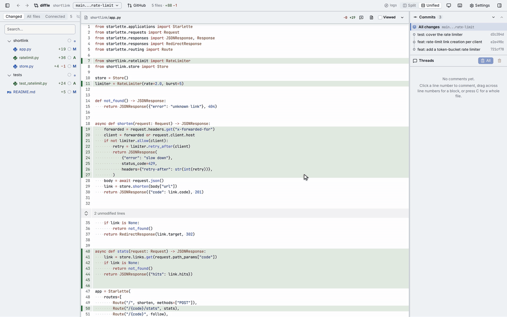

# diffle

[](https://github.com/moritzwilksch/diffle/actions/workflows/ci.yml)
[](https://prefix.dev/channels/conda-forge/packages/diffle)
[](https://prefix.dev/channels/conda-forge/packages/diffle)
[](https://npmx.dev/package/@moritzwilksch/diffle)
[](https://diffle.app)

Review a Git diff in the browser and comment on lines, blocks, or whole files. Then hand the
comments to an agent as a prompt, or to GitHub as a pending review.

<picture>
  <source media="(prefers-color-scheme: dark)" srcset=".github/assets/videos/review-dark.gif">
  <source media="(prefers-color-scheme: light)" srcset=".github/assets/videos/review-light.gif">
  
</picture>

## Install

```bash
pixi global install diffle               # conda-forge
npm install -g @moritzwilksch/diffle     # npm
cargo binstall diffle                    # crates.io, the release binary
cargo install diffle                     # crates.io, compiled from source
```

Or grab the standalone binary. On Linux (x64, arm64, glibc) and Apple silicon macOS:

```bash
curl -fsSL https://diffle.app/install.sh | sh
```

It installs to `~/.local/bin`. Set `DIFFLE_INSTALL_DIR` to change that, or `DIFFLE_VERSION=v0.4.0`
to pin a release. On Windows (x64, arm64), from PowerShell:

```powershell
irm https://diffle.app/install.ps1 | iex
```

It installs to `%LOCALAPPDATA%\Programs\diffle` and adds that to your user PATH; set
`DIFFLE_NO_MODIFY_PATH` to keep the PATH as it is.

To try it without installing:

```bash
npx @moritzwilksch/diffle working
pixi exec diffle working
nix run github:moritzwilksch/diffle -- working
```

The Nix package bundles `gh`; `#minimal` drops it, and `#web`, `#rust`, `#python`, and `#csharp` bundle
language servers. Every package takes more with `withLsps`, and `#unwrapped` is the bare binary:

```nix
diffle.packages.${system}.default.withLsps [ pkgs.gopls pkgs.clang-tools ]
```

To build from source, pixi builds the checkout with `recipe/recipe.yaml` (a Rust toolchain and
Node.js come from conda-forge):

```bash
pixi global install --git https://github.com/moritzwilksch/diffle diffle
```

## Pick what to review

```bash
diffle                  # HEAD vs worktree, like a bare `git diff`
diffle working          # HEAD vs worktree: staged, unstaged, untracked
diffle develop          # what this branch added since it left develop
diffle pr 27            # GitHub PR 27, or its URL; without a number, this branch's PR
diffle show a1b2c3d     # one commit, like `git show`
diffle main..feat       # any git-diff revspec: <rev> | a..b | a...b | a b
diffle main..worktree   # "worktree" names the uncommitted tree on either side
diffle range-diff main..v1 main..v2   # how a series of commits was reworked, like `git range-diff`
diffle --help           # all commands and flags
```

`diffle pr` needs a [GitHub token](#send-comments-to-github). A PR from another repository opens
in a temporary clone.

Closing the last diffle tab stops the server and prints your open comments. Pass `--keep-alive`
to keep it running.

## Review

- `j` / `k`: next or previous line (`10j`: ten lines down)
- `J` / `K`: next or previous file
- `]` / `[`: next or previous hunk
- `c`: comment
- `C`: comment on the whole file
- `V`: select a block
- `R`: resolve
- `v`: mark viewed
- `/`: search the current file
- `g/`: search all changed files
- `gf`: filter files
- `F`: open the full file
- `Ctrl+o`: go back
- `yy`: copy all comments

Press `?` for the full list.

A comparison lists its commits above the threads. Pick one, or step with `<` and `>`, to see
that commit alone; **All changes** returns to the whole range. Comments on a focused commit
belong to that commit, as in `diffle show`.

Comments live in `<git-dir>/diffle/` and never touch your worktree. They follow their text as
the code changes and go stale once it leaves the diff.

Generated files start collapsed, as on GitHub: `linguist-generated` in `.gitattributes` marks
them, and `linguist-generated=false` opts a file out. To collapse other files, add auto-viewed
globs in settings or with `diffle config`.

## Send comments to GitHub

The pull request icon adds one thread, or all open threads, to a pending review on the PR.
diffle never submits it: you edit, drop, and submit the comments on GitHub yourself. Adding a
thread again updates its comment instead of duplicating it.

Export works when the comparison matches the PR's committed diff, so unpushed commits and
worktree changes rule it out. Stale threads are skipped.

diffle takes the token from `GITHUB_TOKEN`, then `GH_TOKEN`, then a signed-in
[`gh`](https://cli.github.com/). Without one, everything except GitHub still works.
`GITHUB_API_URL` points diffle at another GitHub API, as in Actions.

For GitHub Enterprise Server, add its host to `githubHosts` in the config file (`diffle config`
prints its path). Each entry maps the host in remote URLs to the host serving the web UI and
API, the same one unless remotes use another, as an SSH-only host might:

```json
{
  "githubHosts": {
    "github.work.com": "github.work.com",
    "ssh.work.com": "github.work.com"
  }
}
```

A run talks to one GitHub: the pull request URL's, else origin's, else the one all GitHub
remotes share. The token then comes from `GITHUB_ENTERPRISE_TOKEN`, `GH_ENTERPRISE_TOKEN`, or
`gh auth login --hostname <host>`.

## Jump to definitions

diffle starts a language server for each language in the diff, if it finds one on `PATH`:

- `gd` or Ctrl/Cmd+click: definition
- `gy`: type definition
- `gA`: references
- `gs` / `gS`: file or repository symbols
- `gh`: hover, including schema docs for JSON, YAML, and TOML
- `w` / `b` / `0` / `$`: step through a line's symbols; the one under the cursor or the pointer is tinted
  wherever it recurs in the file, writes apart from reads

Results outside the diff, such as the standard library, open read-only. Large repositories can
take a while to index.

`diffle lsp` shows which server each language gets and what to install for the rest:

```
python    pyrefly lsp
rust      not on PATH (tried rust-analyzer)
```

Override a server or turn one off for a run:

```bash
diffle working --lsp python="pyrefly lsp"        # this run only
diffle working --no-lsp                          # none at all
```

Or persistently, in the config file (`diffle config` prints its path and contents):

```json
{ "lspCommands": { "rust": "rust-analyzer", "java": "" } }
```

Language servers run inside the repository and can read anything your user can.
`--no-lsp` starts none.

## Open from lazygit

[lazygit](https://github.com/jesseduffield/lazygit) custom commands open diffle on what is
selected. Add them to its `config.yml` (`lazygit --print-config-dir` prints the folder):

```yaml
customCommands:
  - key: '<c-d>'
    context: 'files'
    command: 'diffle working'
    output: terminal
    description: 'Review uncommitted changes in diffle'
  - key: '<c-d>'
    context: 'commits'
    command: 'diffle {{.SelectedCommitRange.From}}^..{{.SelectedCommitRange.To}}'
    output: terminal
    description: 'Review the selected commits in diffle'
  - key: '<c-d>'
    context: 'localBranches'
    command: 'diffle main...{{.SelectedLocalBranch.Name}}'
    output: terminal
    description: 'Review the branch against main in diffle'
```

lazygit waits while you review; closing the tab returns to it with the open comments printed as
a prompt. Append `| pbcopy` (or your clipboard tool) to a command to copy them instead.

## Shell completions

```bash
diffle completion --shell bash > ~/.local/share/bash-completion/completions/diffle
diffle completion --shell zsh > ~/.local/share/zsh/site-functions/_diffle   # on fpath, before compinit
diffle completion --shell fish > ~/.config/fish/completions/diffle.fish
```

Rerun after upgrading to pick up new commands. Revisions don't complete.

## Behind a reverse proxy

diffle works under a path prefix such as `https://proxy.example/diffle/` with no extra setting.
Have the proxy strip the prefix, including for WebSocket upgrades at `/diffle/ws`, and trust its
public origin:

```bash
diffle working -H 0.0.0.0 --no-open --allowed-origin https://proxy.example
```

If the proxy rewrites Host and Origin to its upstream address, such as a Kubernetes service
name, trust that address instead. A rejected request gets a 403 naming the header that failed.

## Development

The server is Rust (`crates/diffle`), the client TypeScript; you need a Rust toolchain
(`rust-toolchain.toml` pins it) and Node.js.

[pixi](https://pixi.sh) installs the toolchain, git, gh and lefthook from `pixi.lock`, and its tasks
are the entry points, locally and in CI. npm builds and tests the client; cargo builds and tests
the server, whose release build embeds the client.

```bash
pixi run diffle working                   # build the client, then serve the working tree
pixi run test-node && pixi run test-rust  # the client's and the server's suites
pixi run lefthook-run                     # the pre-commit hook over every file, as CI runs it
pixi run build-release                    # the release binary
pixi run diffle lsp                       # the language servers the environment resolves
```

The environment puts real language servers on PATH, so `pixi run diffle working` reviews with them.
`pixi run lefthook-install` wires up the pre-commit hook (`.lefthook.yml`): it formats and lints the staged files, typechecks, and checks file-size and folder limits across the whole tree. `pixi run lefthook-run` runs the same hook over every file, as CI does.
A debug build reads `crates/diffle/client` from disk: after a client change, run `npm run build`
and reload the page. A release build (`cargo build --release`) embeds the client.
`npm run fixture -- <dir>` builds the repository the tests review, covering renames, binaries,
CRLF, and more. The browser suite drives Playwright's Linux Chromium in a Docker container
(`compose.yml`, started and stopped by the suite) while the tests and the release binary run
natively, so screenshots match CI on every host:

```bash
pixi run e2e                              # the browser suite, after the release build
pixi run e2e -g search                    # matching scenarios
pixi run e2e-report                       # open the last report
pixi run e2e --update-snapshots           # accept new screenshots
```

See [AGENTS.md](AGENTS.md) for more.

## Acknowledgements

diffle is inspired by [difit](https://github.com/yoshiko-pg/difit).
Diffs are rendered with [@pierre/diffs](https://github.com/pierrecomputer/pierre).
